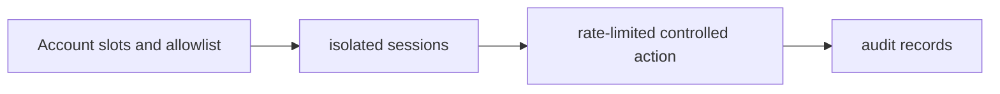

# Multi Account Messaging Lab

**Isolated Telegram sessions, allowlisted actions and audit state.**

  [](LICENSE)

[Overview](#overview) · [Quickstart](#quickstart) · [Example](#example) · [Validation](#validation) · [Documentation](#documentation)

## Overview

A controlled Telegram account-orchestration experiment with per-account sessions, allowlists and audit state.

**Stack:** Python · asyncio · Telethon · SQLite · JSONL

## A controlled account experiment

| Component | Behavior |
| --- | --- |
| Identity | Each configured account has separate local session storage. |
| Scope | An allowlist defines controlled destinations. |
| Accountability | Local rate limits and SQLite/JSONL records track actions. |

## Processing path



## Quickstart

```console
python -m venv .venv
# Activate .venv, then:
python -m pip install -e .
stolas-tg --help
```

The commands above install prerequisites or run the specified offline checks. Live collection, cloud operations, messaging and trading are separate operational steps when present.

## Example

**Inspect the workflow**

Read [the allowlist example](config/allowlist.example.json) before defining an experiment. An account slot, a permitted destination and a rate-limited action form one auditable operation. The CLI retains its internal stolas-tg name; account sessions and live actions are configured separately.

## Configuration and storage

Python 3.11+, asyncio and Telethon. [.env.example](.env.example) supplies credential/config paths; SQLite and JSONL retain local operational state. Use example account/allowlist configuration when inspecting the design.

## Repository guide

| Location | Responsibility |
| --- | --- |
| [src/stolas_tg/cli.py](src/stolas_tg/cli.py) | CLI |
| [src/stolas_tg/config.py](src/stolas_tg/config.py) | Account/config inputs |
| [src/stolas_tg/rate_limit.py](src/stolas_tg/rate_limit.py) | Rate control |
| [src/stolas_tg/storage.py](src/stolas_tg/storage.py) | Audit/state persistence |

## Validation

The quickstart lists the declared checks. No passing CI or coverage claim is implied by the technology badges.

## Scope and operational boundaries

Configured accounts can perform real messaging actions. This repository documents controlled experiments, not unrestricted bulk messaging. Account authorization, session custody and destination consent remain operational prerequisites.

## Documentation

- The repository guide above links directly to the implementation and configuration files.

## License and attribution

Project-authored source code is licensed under the [MIT License](LICENSE). Third-party components and datasets retain their respective rights and licenses.
